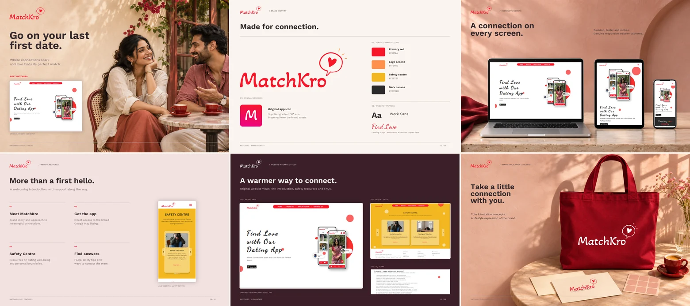

# MatchKro

Find your perfect match with MatchKro!

## Overview

MatchKro is a responsive marketing website for a dating app. It introduces the brand and its approach, links visitors to the Google Play listing, and provides safety resources, FAQs, policy information, and a contact form.

## Project Preview



Website and brand showcase, including presentation mockups.

## Key Features

- Five home-page sections: introduction, quote, About MatchKro, approach, and combined contact/footer.
- Desktop section snapping and a collapsible mobile navigation menu with keyboard dismissal.
- A Safety Centre carousel linking to four dating-safety topics, with two visible cards on desktop/tablet and one on mobile.
- Dedicated FAQ, dating-safety, privacy, terms, cookies, and security pages.
- A contact form with required fields, email validation, duplicate-submit prevention, loading feedback, and success/error states.
- Shared footer navigation and direct links to the app listing and social profiles.

## Live Website

[https://matchkro.vercel.app/](https://matchkro.vercel.app/)

## Technology Stack

| Layer | Implementation |
| --- | --- |
| Pages | HTML5 |
| Styling | Custom CSS and Bootstrap 5.3.1 |
| Interactions | Vanilla JavaScript |
| Icons | Bootstrap Icons 1.10.5 |
| Safety carousel | Splide 4.1.4 |
| Contact submission | Browser Fetch API and SheetDB |
| Fonts | Google Fonts |
| Hosting | Vercel |

## Run Locally

No dependency installation or build step is required. From the repository root, run a static server with Python 3:

```sh
python -m http.server 8000 --bind 127.0.0.1
```

Open [http://127.0.0.1:8000/index.html](http://127.0.0.1:8000/index.html).

Any equivalent static web server can also serve the site. A network connection is needed for CDN libraries, fonts, and the contact service.

## Project Structure

```text
.
├── index.html
├── css/
│   ├── styles.css
│   └── responsive.min.css
├── js/
│   └── scripts.js
├── images/
│   └── project-preview.webp
└── pages/
    ├── safetycentre.html
    ├── datingsafetytips.html
    ├── faq.html
    ├── privacypolicy.html
    ├── t&c.html
    ├── cookiepolicy.html
    └── securitypolicy.html
```

`images/` also contains the website's logos, app imagery, download badge, and decorative assets.

## Contact Integration

The form sends name, email, message, and timestamp fields to the configured SheetDB service. Submission requires that external service to be available. There is no custom backend, authentication system, or environment-variable configuration in this repository.

## Deployment

Serve the repository root as a static site, with `index.html` as the entry point. No build command is needed. Project-relative navigation supports deployment at the domain root or within a subdirectory.
